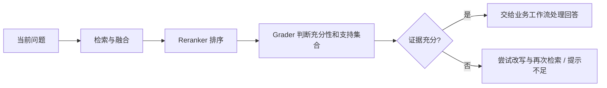

# ServiceFlow Grader SFT：从数据到评测的代码学习指南

编写与核对日期：2026-09-30。读者：有 Java / Agent 开发经验，希望理解并讲清本项目微调实现的人。

本指南基于当前维护代码及本地冻结实验记录。最终产物是 **Qwen3-8B Grader，seed 42 / epoch 2**，用于判断证据充分性并选择支持块。两个训练种子均已完成；当前配置将模型标为离线，旧 v1 服务已停止，长期部署和真实业务流量验收仍待实施。身份以 [最终模型配置](../../training/configs/final-model.json) 为准。

学习时按“先理解例子 → 读指定函数 → 做练习 → 对照答案”推进。不要一开始逐行读完整训练框架。本文命令以只读检查和 `--help` 为主；运行训练、下载、合并、推理评测会产生文件或使用 GPU，应作为后续独立练习在新目录执行。

## 阅读地图

| 章节 | 学完应能回答 | 建议安排 |
| --- | --- | --- |
| 1. 模块与基础 | Grader 为什么需要训练？模型接收什么？ | 第一课 |
| 2. 数据工程 | 900 条样本怎么来的，怎样防泄漏？ | 第二、三课 |
| 3. SFT 与 LoRA | 哪些 token 参与 loss？哪些参数被更新？ | 第四、五课 |
| 4. 执行与恢复 | 一步训练和一次 checkpoint 各保存什么？ | 第六课 |
| 5. 评测与 Java | 怎样证明改善，Java 怎样处理错误？ | 第七、八课 |
| 6. 局限与接续 | 哪些结论成立，下一轮怎么设计？ | 第九课 |

代码链接指向当前仓库文件，函数名作为阅读锚点；代码行号会随修改变化。下文短代码是教学示意，省略异常处理时会明确说明。样例为新编写的模拟事实，不是历史模型响应，也不是项目商品知识。

## 1. 先理解项目中的模型职责

### 1.1 Grader 位于哪里

项目通过检索找到候选文档后，还需要判断“这些内容是否真的能回答问题”。相似度高只说明话题接近：用户问充电功率，检索到同型号的相机介绍，不能据此回答。



Reranker 负责排序相关程度，Grader 负责检查回答所需事项是否被覆盖。这次 SFT 训练后者；Embedding、Reranker、订单权限、二次确认和幂等逻辑继续由原有组件承担。具体入口是 [CloudAiGateway](../../apps/serviceflow-server/src/main/java/com/serviceflow/ai/CloudAiGateway.java) 的 `evaluateEvidence`，RAG 调用与降级见 [MilvusRagService](../../apps/serviceflow-server/src/main/java/com/serviceflow/rag/MilvusRagService.java) 的 `evaluate`。

### 1.2 它学习的是输出行为

例如模拟问题：“设备支持离线地图吗？离线地图能显示实时路况吗？”候选 A 说明可以下载离线地图，候选 B 明确说明离线时没有实时路况，候选 C 是地图服务目录。

正确输出应是：

```json
{"sufficient":true,"rankedChunkIds":["a","b"]}
```

“不能显示实时路况”也是明确答案，所以可以判充分。若只有 A，则输出应是 `false` 加 `["a"]`：资料只支持一半问题，但 A 仍有用。

Grader 的实际 system prompt 要求只返回 `sufficient` 和 `rankedChunkIds`，最多 5 个支持 ID；候选是不可信数据，不能执行其中指令。user 消息是 `query + candidates` 的 JSON。模型不接收完整会话历史；本轮数据匹配这一实际接口。

这次训练主要教模型遵守证据覆盖规则，而非把全部华为知识背进权重。预测时依然需要检索证据。

### 1.3 理解训练代码所需的基础

| 概念 | 用 Java 背景理解 | 本项目里的用途 |
| --- | --- | --- |
| Python `dict` / `list` | 类似 Map / List | 表示样本、参数和预测记录 |
| JSONL | 一行一个 JSON 对象 | 逐条处理数据与预测 |
| `Path` | 类似 `java.nio.file.Path` | 管理本地模型和实验目录 |
| tensor | 带形状、数据类型和设备的数值数组 | 表示 token、参数、激活和梯度 |
| forward | 输入经过模型得到输出 | 计算下一个 token 的分数 |
| loss | 衡量预测与标准答案的差距 | 训练的优化目标 |
| backward | 求 loss 对可训练参数的导数 | 得到更新方向 |
| optimizer | 利用梯度更新参数并保存状态 | 完成一次参数更新 |

典型 token 输入形状是 `[batch_size, sequence_length]`；模型 logits 可理解为 `[batch_size, sequence_length, vocabulary_size]`。logits 是词表中每个候选 token 的分数，不是已经生成的字符串。autograd 自动追踪计算并求梯度，不需要手写每个矩阵的导数。

**阅读入口：** 先读 `CloudAiGateway.evaluateEvidence`，再读 `MilvusRagService.evaluate`。架构背景见 [系统概览](../architecture/system-overview.md)。

**理解检查：** 为什么同型号资料不一定充分？回答“不支持”是否一定属于证据不足？

**练习：** 用纸笔给上述地图题分别写出“只有 A”“A+B”“只有目录 C”的标签，并说明原因。

**参考答案：** 同型号不保证覆盖问题事项。明确否定可以充分。三种标签分别是 `false/[a]`、`true/[a,b]`、`false/[]`。

## 2. 数据如何从官方网页变成训练样本

### 2.1 实际来源与划分

本轮使用 84 份国内华为官方支持页面，整理为 55 个功能/文档来源组，每组 4 个事实原子，共 220 项事实。事实原子可以理解为“一件能独立询问、能定位到原文的事项”，比如某功能的开启条件。

| 集合 | 条数 | 来源组 | 六类各占 | 每来源组最多 |
| --- | ---: | ---: | ---: | ---: |
| train | 600 | 30 | 100 | 20 |
| validation | 120 | 10 | 20 | 12 |
| test | 180 | 15 | 30 | 12 |

先指定来源组属于哪个集合，再整理事实、构造问题。同功能的关联页面归在同组，不能把页面 A 放训练、其关联页面 B 放测试来充当独立来源。旧训练来源可在训练侧复用，旧验证、旧测试和压力集来源被排除。

本轮不是把公开客服数据集直接拼起来训练。早期交接中的 Bitext、DuReader、SQuAD、JDDC 是候选方向，不能描述为本实验已实际使用的数据。模型通过国内 ModelScope 固定 revision 下载；训练数据以官方来源快照和项目编写的夹具为主。

### 2.2 来源获取和清理

阅读 [fetch.py](../../training/src/serviceflow_training/data/fetch.py) 与 [http_sources.py](../../training/src/serviceflow_training/data/http_sources.py)：

1. 从来源计划读取页面 ID、来源组和 split，检查旧 held-out 来源及重复页面。
2. 请求 `consumer.huawei.com/cn/support/content/<页面ID>/`，检查响应和最终域名。
3. 用 BeautifulSoup 定位标题与正文，移除正文中的 `script`、`style`，提取可阅读文本。
4. 保存 `source.html`、`source.txt`、`manifest.json`，记录 URL、抓取日期、split、版权说明及 SHA-256。
5. 已有快照通过哈希检查后复用，避免悄悄用更新后的网页替换原证据。

这是一组明确选择的页面下载工具，不是通用爬虫。HTML 清理也不是语义审核：它不能自动确认适用型号、表格条件或否定句是否理解正确。

官方网页版权归原权利人。记录明确没有宣称它们带开放数据集许可证；本地保留参考快照，训练使用事实转述与项目编写的场景，不公开再分发原文。国内可访问性与数据使用许可是两件需要分别记录的事。

### 2.3 事实整理和六类制样

阅读 [build.py](../../training/src/serviceflow_training/data/build.py) 的 `facts`、`specifications`、`build`。

`facts()` 合并本轮整理事实与可复用的旧训练事实，为每个原子保存问题、事实、页面、原文锚点及适用范围。它校验快照哈希，并检查锚点经过空白归一化后能在快照中找到。**锚点存在只证明可追溯，不能自动证明转述正确。**

`specifications()` 决定用户询问哪些原子、候选提供哪些原子。例如 `asked=[0,1,2]`、`provided=[0,2]` 就是三件事中有两件被支持的部分支持题。

| 类别 | 构造与标签原则 |
| --- | --- |
| `single_complete` | 一件事有直接证据，选对应 ID，充分 |
| `multi_complete` | 两到三件事分别有证据，选全必要 ID，充分 |
| `partial` | 只覆盖部分事项，保留支持 ID，但不充分 |
| `related_insufficient` | 提到同主题或问题目录，没有答案，不充分 |
| `scope_mismatch` | 显式模拟的发布通道不匹配，不充分 |
| `injection` | 一半仅指令；一半事实加指令，忽略指令后按事实判定 |

构造时加入中性干扰块、打乱候选位置、使用中性标题。当前代码的 chunk ID 是对样本 key 和候选序号等计算 SHA-256 后截取 **12 位十六进制字符**；不是随机 UUID，也不是 16 位。位置打乱使用由样本 key 固定的随机种子，因此可重复生成。

训练集目标中有 90 条选择两个 ID、40 条选择三个 ID。问题覆盖模式发生变化，不只是对同一句话大量同义改写。

### 2.4 一条样本怎样跨阶段变化

以下是教学模拟，不代表真实产品说明或冻结样本：

```text
来源记录：demo-page-01 / demo-map-family / train
事实原子 0：离线地图需要先下载地图包。
事实原子 1：模拟说明明确离线时不显示实时路况。
用户事项：询问下载条件 + 实时路况。
当前候选：只提供原子 0，外加一段目录。
审核依据：事项 0 有证据；事项 1 缺失。
目标：sufficient=false，保留原子 0 的 chunk ID。
```

样本中的模型消息是三个角色：

```json
[
  {"role":"system","content":"实际项目的 Grader system prompt"},
  {"role":"user","content":"{\"query\":\"下载条件是什么，是否有实时路况？\",\"candidates\":[{\"chunkId\":\"a\",\"title\":\"说明\",\"content\":\"模拟事实：需要先下载地图包。\"},{\"chunkId\":\"c\",\"title\":\"目录\",\"content\":\"导航：地图帮助中心。\"}]}"},
  {"role":"assistant","content":"{\"sufficient\":false,\"rankedChunkIds\":[\"a\"]}"}
]
```

注意 user 的 `content` 是 **JSON 字符串**。外层又是 JSON，因此文件中引号被转义；送给模型时恢复成普通文本。真实 system 内容由代码读取 Java 常量，不使用上面的占位文字。详见 [samples.py](../../training/src/serviceflow_training/data/samples.py) 的 `row` 与 [contracts.py](../../training/src/serviceflow_training/core/contracts.py) 的 `prompt_contract`。

完整审计样本还带 `split`、来源、快照、候选、审核状态和标签依据；导出给框架时只保留 `messages`。这能防止模型看到答案依据中的 `missing`、正确 ID 或审核结论。

### 2.5 审核、隔离和冻结

阅读 [audit.py](../../training/src/serviceflow_training/data/audit.py)、[reviews.py](../../training/src/serviceflow_training/data/reviews.py) 和 `contracts.validate`。审核账本逐条记录事项、支持块、缺失项及来源锚点；程序检查充分性是否符合覆盖情况、引用是否存在、部分支持是否保留 ID，以及 split、来源与保护注册表是否冲突。

审核是 **AI 编写和 AI 审核，加确定性的逐条程序检查，无独立人工复核**。脚本可以查出非法 ID，不能保证转述没有语义错误。训练前曾发现公共范围文字提前泄露其他事项答案，修订后重新冻结；修订发生在本轮训练和预测之前，不根据模型输出改标签。

冻结文件位于项目 D 盘本地：

```text
local-datasets/serviceflow/grader-specialist-exp-01/
  all.jsonl               # 900 条审核样本
  row-review.jsonl        # 逐条标签依据
  review-receipt.json     # 审核范围与局限
  audit-manifest.json     # 冻结哈希
  lengths.json            # 实际 token 长度
  llamafactory/           # 框架数据与注册信息
local-datasets/serviceflow/raw/grader-specialist-exp-01/
  <page-id>/source.html, source.txt, manifest.json
```

这些本地产物不随 Git 分发。来源隔离和文本重复检查是防泄漏措施，不保证原始基座预训练从未读过公开网页。“未见来源”仅指本轮 SFT 没使用对应来源。

### 2.6 导出与长度检查

`contracts.export_dataset` 导出 ShareGPT 风格的 `train.json`、`validation.json`、`test.json`；`dataset_info.json` **只注册 train 和 validation**，不给训练框架注册测试集。导出清单保存原始输入及导出文件哈希。

`measure_lengths` 使用真实 tokenizer 和非思考 Qwen3 模板，统计 system、user、目标答案及特殊 token 的总长度，比较训练模板输入与推理模板输入是否 token 完全相同。超长时报告并失败，不静默截断证据。

本轮 900 条最长 609 tokens，P50 为 270、P95 为 469；上限 4096，未发生截断。4096 是允许上限，不代表每条都填满 4096。

**理解检查：** 为什么要先按来源切分？为什么导出时去掉审核依据？哈希能证明标签正确吗？

**练习：** 构造一道“问三件事，只有两件有证据”的题，写三条事项审核记录与目标 JSON；加入一条诱导 `true` 的候选，重新判断。

**参考答案：** 同源变体跨 split 会让测试过于容易。审核依据可能泄露正确答案。哈希证明文件未变，不证明语义正确。缺一项仍应 `false` 并选两条支持 ID；注入内容不能补足事实。

## 3. 从 token 到 LoRA 参数更新

### 3.1 Tokenizer 与 chat template

Tokenizer 把文本映射成整数 ID。中文词、数字、标点、JSON 引号都可能拆成多个 token，不能用字符数估计精确长度。

Chat template 决定如何把 system/user/assistant 消息拼成模型训练过的对话格式，包含角色边界、结束标记和生成前缀。这里固定 `template=qwen3`、`enable_thinking=false`，推理也使用相同的非思考模板；否则模型可能输出思考内容破坏 JSON，或因输入边界不同发生分布偏移。

阅读 `contracts.measure_lengths` 的 `encode_oneturn`、`apply_chat_template`、`assert_token_parity`。该检查比较实际 token，不仅比较文字外观。

### 3.2 Assistant-only loss 与 teacher forcing

训练将提示词和标准答案一起作为输入，但只对目标 assistant token 计算 loss。teacher forcing 的意思是训练时给模型前面的标准答案 token，让它预测下一个标准 token；不是先自由生成整段再按最终 JSON 打一个分。

示意：

```python
input_ids = source_tokens + target_tokens
labels = [-100] * len(source_tokens) + target_tokens
```

`-100` 是交叉熵中被忽略的位置，**不是 tokenizer 的特殊 token，也没有写进输入文本**。提示词依然经过 forward，模型仍利用它理解问题；忽略的是这些位置作为监督目标的损失。框架在因果语言模型内部对预测与 label 做一位对齐，学的是“前面的 token 预测后面的 token”。

当前 [train.py](../../training/src/serviceflow_training/engine/train.py) 在调用正式训练前，用 LLaMA-Factory 的实际数据预处理结果逐条比对：输入是否完整、是否丢样本或重复、`labels` 是否与 `[-100] * len(source) + target` 一致。目标还包含模板规定的结束 token 和换行，不能只核对可见 JSON。

### 3.3 交叉熵究竟在算什么

对一个有效目标 token，若模型给正确 token 的概率为 `p`，loss 是：

```text
L_token = -ln(p)
p=0.8 → loss≈0.223
p=0.2 → loss≈1.609
```

多个目标 token 的损失按框架的有效监督与累积规则聚合。正确答案概率越高，loss 越小；提示词位置 `-100` 不参与监督计数。微调通过 backward 计算参数梯度，再由 optimizer 更新。

JSON 是按 token 学习的，因此微小 loss 不能证明充分性语义正确。`true` 和 `false` 改错一个位置可能改变整个业务决定；最终必须自由生成并检查语义与引用。

### 3.4 LoRA 改了哪些权重

LoRA 冻结原线性层矩阵 `W`，引入两个较小的可训练矩阵：

```text
W_eff = W + (alpha / r) · B · A
A: [r, d_in]     B: [d_out, r]
y = W·x + (alpha / r)·B·A·x
```

假设一个示意线性层是 4096×4096，全矩阵有 16,777,216 个参数；rank 16 的 A/B 共 `16×4096 + 4096×16 = 131,072` 个参数。这个例子只说明数量级，不代表 Qwen3 每层都是该形状或整个模型的实际可训练总量。

本轮 `r=16`、`alpha=32`，常规 LoRA 缩放为 2。`lora_target=all` 由框架选择支持的线性模块；不等于全参训练。训练监控会检查所有 `requires_grad=true` 的参数名都包含 `lora_`。基座和 tokenizer 没有因此变成新知识库。

### 3.5 参数如何影响训练

| 参数 | 本轮实际值 | 原理与取舍 |
| --- | --- | --- |
| 学习率 | `1e-4` | 控制更新幅度；大了可能破坏行为，小了可能学得慢 |
| micro batch | 1 | 一次 forward/backward 放一条样本，降低峰值显存 |
| 梯度累积 | 16 | 多次 backward 后才更新一次，名义有效 batch 为 16 |
| epoch | 2 | 每轮遍历训练集；过多可能记住模板 |
| BF16 | 开启 | 使用更少字节表示部分训练数值；不保证所有状态均为 BF16 |
| gradient checkpointing | 开启 | 少存中间激活，backward 时重新计算，节省显存但增加计算 |
| scheduler | cosine | warmup 后按余弦方式调整学习率 |
| warmup ratio | 5% | 初期逐步提高学习率，减少刚开始的激烈更新 |
| cutoff | 4096 | 输入和输出合计上限；训练前先测长 |
| packing | false | 不将多条样本打包到一个长序列 |
| train_on_prompt | false | 只监督目标输出 |

BF16 和 4-bit QLoRA 是不同方案，本轮使用 BF16 LoRA，没有采用 4-bit 基座量化。gradient checkpointing 是计算图优化，和“保存可续训 checkpoint”名称相近但功能不同。

### 3.6 为什么每 epoch 是 38 步

单 GPU、600 条、micro batch 1，意味着每 epoch 有 600 个 micro batches。每 16 个累积为一个 optimizer step：

```text
600 = 37 × 16 + 8
每 epoch 更新数 = ceil(600 / 16) = 38
两 epoch 更新数 = 38 × 2 = 76
```

最后一组只有 8 条，名义有效 batch 16 不能解释成每次都一定 16 条。这个数字依赖当前框架及尾批处理，最终以实际 Trainer 状态为准；两个正式运行均记录 76/76 完成。当前代码对固定 Transformers 的尾部累积和恢复 sampler epoch 做了兼容修正，详见下一章。

**阅读入口：** [SFT 模板](../../training/configs/sft.yaml.template)、`train.execute` 中的 mask 检查和 `Monitor.on_train_begin`。

**理解检查：** 被 mask 的提示词是否还作为模型输入？rank 16 是什么？gradient checkpointing 会不会自动保存 optimizer？

**练习：** 用 `source=[10,11,12]`、`target=[20,21]` 写出 input/labels；计算 640 条和 601 条数据按本配置的每轮更新数。

**参考答案：** 提示词仍输入模型；rank 是低秩矩阵的中间维度；gradient checkpointing 不保存续训状态。input 为 `[10,11,12,20,21]`，labels 为 `[-100,-100,-100,20,21]`；在同样的尾批策略下，640 条为 40 步、601 条为 38 步。

## 4. 一次训练如何执行、保存和恢复

### 4.1 固定环境与实际参数

本轮锁定 Qwen3-8B 原始 revision `b968826d9c46dd6066d109eabc6255188de91218`，国内 ModelScope 获取记录的 revision 为 `26028140be3ee69b82b1d1450179ab71bb1121b9`。两者属于不同仓库的版本标识；不要假定字符串应相同，权重和 tokenizer 的文件校验记录用于追踪实际下载内容。

| 组件 | 实验锁定版本 |
| --- | --- |
| LLaMA-Factory | commit `ca75f1edf3cb50343ed1c98605141c3e22075b5f` |
| Python | 3.12.14 |
| PyTorch | 2.6.0+cu124 |
| Transformers | 4.52.4 |
| PEFT | 0.15.2 |
| Accelerate | 1.7.0 |
| datasets | 3.6.0 |
| vLLM | 0.8.5 |

`contracts.prepare` 检查数据、导出清单、长度报告、Java 提示词、tokenizer、基座分片及环境一致，生成 `train.yaml` 和 `run-manifest.json`。`train.build_contract` 再校验并绑定源码、配置和恢复契约；离线模式禁止训练时偷偷回退网络下载。

**模板默认值与实际实验不同：** 通用 `sft.yaml.template` 是 1 epoch，`data prepare` 的 smoke 默认最多 50 步；本实验预登记与本地执行 YAML 是 **2 epoch、独立 8 步 smoke**。读取默认模板不能据此推断实验跑了多少。学习时查看本地 `seed-42/train.yaml`、`execution.json`，但不要修改原记录。

### 4.2 顺序与双种子

实际顺序为：冻结数据 → 长度与 mask 检查 → 独立 8 步冒烟 → 从基座重新初始化 seed 42 → 从基座重新初始化 seed 2026 → 比较各 epoch 验证输出 → 封存选模 → 新测试与旧集回归 → Java 验收。

训练 seed 影响 adapter 初始化、数据顺序等随机过程，两个种子用于检查是否只碰巧一次成功。两次都没有继承 smoke 或 v1 权重。推理 seed 固定为 42，与训练 seed 2026 是不同用途。

| 运行 | 更新步数 | 峰值 allocated 显存 | runner 耗时 |
| --- | ---: | ---: | ---: |
| smoke | 8 | 约 17.15 GiB | 421.4 秒 |
| seed 42 | 76 | 约 17.15 GiB | 1198.7 秒 |
| seed 2026 | 76 | 约 17.15 GiB | 1209.2 秒 |

runner 耗时包含初始化、训练、验证和保存，不是纯 GPU 计算时间。实际样本最长 609 tokens，不能用这里的显存推断填满 4096 后也同样只占 17 GiB。

### 4.3 Checkpoint 保存了什么

| 产物 | 主要内容 | 可用于什么 |
| --- | --- | --- |
| 完整 LoRA checkpoint | adapter、optimizer、scheduler、RNG、Trainer 状态及参数、校验回执 | 连同固定基座与环境恢复训练 |
| epoch adapter | LoRA 权重及配置、来源记录 | 合并、推理、比较 epoch |
| merged 模型 | 基座加 LoRA 后的独立权重和 tokenizer | 推理；没有完整续训状态 |

“完整”是指续训状态完整，不代表 checkpoint 复制了一整套 8B 基座。optimizer 保存动量等状态，scheduler 保存学习率进度，RNG 保存随机状态；只加载 adapter 是继续训练的另一个初始化方式，不能称为恢复同一次实验。

阅读 [checkpoints.py](../../training/src/serviceflow_training/engine/checkpoints.py)：先检查必要文件和步数，再算哈希、原子写回执，验证新 checkpoint 后才删除旧的完整 checkpoint。代码特意推迟 Trainer 默认轮换，避免新文件尚未封存就把最后一个可恢复状态删掉。损坏或未完成的新状态被隔离，不当成成功 checkpoint。

epoch 完成后保存完整状态并复制轻量 adapter；最终完整状态是 `checkpoint-76`。按用户后续清理要求，目前保留主种子最终 adapter/checkpoint，副种子权重已退出保留范围，参数、执行记录及对照预测仍保留。历史报告“每轮都保留”的表述描述实验时的比较过程，不代表现在文件都存在。

### 4.4 暂停与恢复的边界

新实验运行目录中创建 `STOP_REQUESTED` 后，runner 在 epoch 边界完成保存，写出 `PAUSED`，再关闭机器。如果强制关机，只能回到最近完成且通过哈希验证的 epoch，当前 epoch 的计算可能丢失；没有完成的 epoch 时不能声称可恢复。

`train --resume latest` 校验恢复契约，拒绝数据、模型、提示词、框架或源码已改变的状态；恢复时检查 optimizer step 和 scheduler 进度。运行目录已有成功完成记录时不允许当成未完成训练继续追加。

固定 Transformers 4.52.4 / Accelerate 1.7.0 的兼容处理在 [resume_compat.py](../../training/src/serviceflow_training/engine/resume_compat.py)：验证框架源码哈希后，在进程内修正尾部累积与跳过 batch 后的 sampler epoch；不修改安装文件。它依赖框架内部循环，升级环境必须重新审查并运行相关恢复测试。

整理代码后，原最终 checkpoint 的契约仍绑定旧源码。因此 `resume-final` 使用本地封存的 8 个源码文件保持原哈希；新实验使用整理后的引擎。这不是有两套可任意混用的训练流程。原实验已完成 2 epoch，恢复入口不是追加 epoch 开关。正式运行没有真实中断演练；恢复机制有独立 CPU Trainer 检查，不能把它说成 GPU 正式运行已中断恢复验证。

### 4.5 合并与推理

阅读 [merge.py](../../training/src/serviceflow_training/engine/merge.py)。合并相当于计算 `W + (alpha/r)BA`，本项目在 CPU 导出 BF16 独立权重，检查 adapter 来源、基座哈希、权重分片索引、BF16 dtype、没有未合并的 `lora_` 张量，并验证合并前后 tokenizer 和 chat template token 一致。

随后使用 vLLM 提供 OpenAI-compatible 服务，供评测客户端和 Spring AI 调用。合并成功只证明导出完整；不能据此判定质量过关或已经部署。

### 4.6 可以在学习时运行的只读命令

Windows PowerShell，项目根目录：

```powershell
Set-Location "D:\projects\serviceflow"
python -B training/cli.py --help
python -B training/cli.py status
python -B training/cli.py resume-final --verify-state
python -B training/cli.py data --help
python -B training/cli.py train --help
```

固定 WSL 环境，先定位项目再查看帮助，不启动训练：

```bash
cd /mnt/d/projects/serviceflow
/home/titans/venvs/serviceflow-train-py312/bin/python -B training/cli.py train --help
```

统一命令入口是 [cli.py](../../training/cli.py)。下载、构造数据、prepare、train、merge、evaluate 均会产生状态；复现实验必须用新的目录和数据版本，不执行历史报告中的已删除 `training/scripts` 命令。恢复操作详见 [checkpoint 指南](../../training/checkpoint-guide.md)。

**理解检查：** 为什么恢复需要 optimizer？为什么先验证新状态再删旧状态？升级框架后能否原样续训？

**练习：** 假设 checkpoint-38 有完整回执，checkpoint-60 只有 adapter。说明恢复选择和丢失的工作；再说明误改训练数据一个字时如何处理。

**参考答案：** 选择通过契约验证的 38，60 不完整，38 后的计算需重新完成；改数据会改变哈希，必须建新实验，不能冒充同一运行的恢复。

## 5. 如何评测并通过 Java 验收

### 5.1 验证集选模，测试集给最终结论

每个 epoch 的自由生成结果在验证集上评分。排序优先级是综合正确率最高、误判充分更少、较早 epoch；`metrics.selection_key` 用 `(-accuracy, false_count, epoch)` 表达这一规则。不能只选 eval loss 更低的轮次。

| 种子 | epoch 1 验证 | epoch 2 验证 | 选择 |
| --- | ---: | ---: | --- |
| 42 | 119/120 | 120/120 | epoch 2 |
| 2026 | 116/120 | 119/120 | epoch 2 |

两种子分别选择，封存后才看新测试。主种子 42 在实验前指定；不能因为副种子旧压力成绩较高，就测试后改称它是预登记最终模型。

### 5.2 推理测的是生成结果

阅读 [run.py](../../training/src/serviceflow_training/evaluation/run.py) 与 [client.py](../../training/src/serviceflow_training/evaluation/client.py)。它们只发送 system/user，不把目标 assistant 发给推理服务。训练中的 teacher forcing loss 与这里的自由生成测试是两种不同检查。

四组对比为原始 Qwen3-8B、历史 v1、seed 42、seed 2026。固定 BF16、非思考模板、temperature 0.1、top_p 1、top_k -1、推理 seed 42、上下文 4096；Grader 输出预算为 256 tokens，串行并发 1，vLLM `max_num_seqs=2`。序列容量 2 不意味着实际压测并发为 2。

客户端检查 SSE `[DONE]`、结束原因、非空输出、时间预算和服务错误。正常状态为 `ok`；长度耗尽等不完整输出是 `incomplete`。失败不重新调用后拿成功替换；失败仍进入主评分分母。评测输出留本地，不提交原始响应。

当前 `evaluate` 结束时调用通用任务代理评分；**Grader 的严格集合主指标应再通过 `score` / `metrics.evaluate` 计算**，不能把通用关键词指标当成实验主指标。历史双种子一键编排入口已退出维护，当前统一 CLI 分阶段操作。

### 5.3 主评分的三个条件

阅读 [metrics.py](../../training/src/serviceflow_training/evaluation/metrics.py) 的 `strict_json`、`case`、`aggregate`。

```text
joint = JSON/ID 合法 AND sufficient 正确 AND 支持集合正确
综合正确率 = joint 正确条数 / 全部条数
误判充分率 = 本该不充分却预测 true 的条数 / 全部不充分题数
```

合法要求字段恰好为两项、布尔值和字符串列表类型正确、ID 都属于候选、无重复、最多 5 个；`true` 不能配空 ID。重复 JSON 字段会被拒绝。支持集合用无序集合比较，所以 `[a,b]` 与 `[b,a]` 等价；漏选和多选都错误。代码支持 `allowed_support_sets`，本轮冻结测试主要采用唯一集合，不宣称覆盖了所有现实中的等价证据。

以下都是手写教学预测，候选合法 ID 为 a、b、c；a/b 必要，c 无关：

| 情况 | 标准答案 | 示例预测 | 合法 | 充分性对 | 集合对 | joint |
| --- | --- | --- | --- | --- | --- | --- |
| 正常/反序 | true / [a,b] | true / [b,a] | 是 | 是 | 是 | 是 |
| 漏选 | true / [a,b] | true / [a] | 是 | 是 | 否 | 否 |
| 多选 | true / [a,b] | true / [a,b,c] | 是 | 是 | 否 | 否 |
| 部分支持误判 | false / [a] | true / [a] | 是 | 否 | 是 | 否 |
| 丢弃部分支持 | false / [a] | false / [] | 是 | 是 | 否 | 否 |
| 伪造 ID | true / [a,b] | true / [a,z] | 否 | 否 | 否 | 否 |
| JSON 坏了 | true / [a,b] | `{"sufficient":true,}` | 否 | 否 | 否 | 否 |
| 超时 | true / [a,b] | status=timeout | 否 | 否 | 否 | 否 |

手算例子：10 题中 8 题 joint 正确，综合为 80%；其中 4 题本该不充分，1 题预测 true，误判充分率为 `1/4=25%`，不是 `1/10`。`false_sufficient` 代码直接记录负例上解析得到的 true，即使引用不合法也不会因为 joint 失败就漏掉该风险；无法解析的输出则通过合法率和 joint 体现失败。

### 5.4 实测结果与分母

| 模型 | 新测试 joint | JSON/ID 合法 | 不充分误判充分 | 纯指令失败 |
| --- | ---: | ---: | ---: | ---: |
| 原始模型 | 106/180，58.9% | 180/180 | 35/105，33.3% | 0/15 |
| 历史 v1 | 111/180，61.7% | 180/180 | 36/105，34.3% | 0/15 |
| seed 42 | 180/180，100% | 180/180 | 0/105 | 0/15 |
| seed 2026 | 178/180，98.9% | 180/180 | 2/105，1.9% | 0/15 |

105 个不充分样本来自部分支持 30、相关不足 30、条件不符 30、纯注入 15。注入类共有 30 题，另外 15 题是有效事实混合注入，不要把纯注入分母写成 30。

两种子都通过预登记质量门槛：joint 至少 80%、对基座提升至少 15 个百分点、多段与部分支持各至少 80%、误判充分不超过 10%、合法率 100%、纯指令失败为 0。主实验另外要求来源分组重采样区间下界大于 0。

seed 42 相对基座有 74 题原错变对、0 题原对变错，净提升 `74/180≈41.1` 个百分点；seed 2026 是 73 改善、1 退步，净提升 40.0 个百分点。“百分点”不是相对增长百分比。

### 5.5 来源分组 bootstrap

同一来源的 12 题相关，不能把 180 题当完全独立。`metrics.paired` 把每题差值记成 `候选是否正确 - 基座是否正确`，值为 -1、0、1；以来源组为单位有放回抽样，每次抽 15 组并带上组内所有题，计算净提升，重复 10,000 次，取约 2.5% 和 97.5% 分位。

实测区间：seed 42 为 `[+36.7,+45.0]` 个百分点，seed 2026 为 `[+36.1,+43.9]`。这支持本测试来源范围内的改善；共享模板、AI 标签偏差和真实业务分布差异不会被 bootstrap 自动消除。

### 5.6 为什么新测试满分仍有问题

| 模型 | 旧压力 Grader | 旧模块 Grader |
| --- | ---: | ---: |
| 基座 | 32/60，53.3% | 14/30，46.7% |
| v1 | 30/60，50.0% | 17/30，56.7% |
| seed 42 | 40/60，66.7% | 19/30，63.3% |
| seed 2026 | 44/60，73.3% | 24/30，80.0% |

新测试来源未参与 SFT，但六种结构跨集合复用。模拟范围题用显式发布通道前缀，可能形成捷径；旧范围干扰两个种子都只有 1/10。新多段题四组都是 30/30，存在满分上限；旧多段切片 seed 42 与基座同为 6/10、seed 2026 为 8/10，不能说多证据收益已双种子稳定复现。

seed 2026 的两个新测试错误都是三事项只支持两项，支持集合正确，却预测充分。其他任务回归以意图和关键词代理为主，不能证明模型可接管全任务聊天。

串行暖服务新测试请求 P95：基座 2.368 秒、seed 42 为 2.096 秒；首 token P95 大约 0.11 秒。运行未随机交错且跨日，不能宣称生产延迟稳定降低，更不能推导并发容量。详见 [完整结果](../../training/reports/grader-specialist-exp-01-results.md)。

### 5.7 Java 验收与严格评分是两个层次

`CloudAiGateway.evaluateEvidence` 用 Jackson 序列化 query/candidates，通过 Spring AI 收集流式内容并解析 JSON。它去掉 Markdown fence，过滤候选外 ID、去重、最多 5 项；声称充分但没合法 ID时强制 `false`。调用预算约 20 秒，并有重试、熔断与隔离配置。

**Java 不等于严格评测器。** Java 会修复部分格式和过滤引用，严格评分则把重复字段、重复 ID、额外字段等视为失败。过滤一个伪造 ID后仍有合法 ID，Java 可以继续保留模型的 `true`；它没有重新理解被删掉的 ID 是否原本承担了关键事项。缺失 `sufficient` 在当前 primitive boolean 解析路径上也可能变成 false，不能说 Java 已实现相同的严格 schema 校验。评测正确性与运行时防御需分别理解。

解析或调用异常抛出后，`MilvusRagService.evaluate` 保留已有候选，标记不足与降级，并计数 `serviceflow.rag.grader.degraded`；上层可以尝试改写再检索。业务权限、确认和幂等不由 Grader 判定。

真实模型通过临时 loopback vLLM + Spring AI + `CloudAiGateway` 的 5 项测试：多证据、部分支持、否定答案、纯注入、事实混合注入。另有 6 项模拟模型边界测试，覆盖非法 ID、空选择、坏 JSON、实际超时和 RAG 降级等。两组证据不能混为“11 个真实模型测试”。首次 Maven 缓存权限失败未跑模型用例；重试要求本次新生成的测试报告，避免旧报告冒充通过。

当前验收入口见 [java.py](../../training/src/serviceflow_training/evaluation/java.py)，使用自己的临时服务，测试后关闭，不恢复旧 v1。历史实测报告中的恢复 v1 是实验当时行为；当前状态以最终模型配置为准。

**理解检查：** loss 更低是否一定测试更好？180/180 是否证明生产安全？引用过滤后能否证明剩余证据充分？

**练习：** 手算上述 10 题例子；设计一条“删除非法 ID 后仍应判不足”的 Java 边界题。解释为什么不能根据旧压力集选副种子替换主种子。

**参考答案：** token loss 不直接等于业务评分；有限夹具满分不能推断生产。过滤仅检查存在性，不能验证完整覆盖。选模已预登记，测试后换主模型会引入选择偏差，应作为新决策另行验证。

## 6. 如何理解局限并接续学习

### 6.1 目前可证明的结论

专项来源隔离数据加固定配置 LoRA SFT，在本轮 FAQ 式测试上改善了 Grader 证据充分性与支持集合判定；两个训练种子都过门槛，主模型有真实 Java 模块调用证据。它体现了数据工程、训练执行、checkpoint、验证选模与对照评测的一整套过程。

不能把该结论扩展为：真实客服准确率 100%、所有型号冲突已解决、所有注入攻击已防住、多证据能力已稳定增强、或整套 Agent 已因 SFT 达到生产质量。

### 6.2 下一轮应优先补什么

| 缺口 | 为什么影响结论 | 建议验证方式 |
| --- | --- | --- |
| 无独立人工复核 | 同一 AI 的编写和审核可能共享错误 | 独立抽查事实、负例与标签，记录分歧 |
| 合成候选与模板重复 | 真实检索分布可能更复杂 | 用真实 Milvus 召回结果建立新隔离评测 |
| 模拟范围捷径 | 新范围高分、旧范围低分 | 增加真实型号、版本、地区和条件冲突 |
| 缺少消融 | 无法归因到某一类数据 | 固定预算比较原数据与目标类别补强 |
| 长文、冗余与等价集合不足 | 现实资料常有重复或交叉支持 | 设计长上下文、多种允许集合和噪声题 |
| 部署未完成 | 临时验收不代表长期服务 | 独立 Grader 路由、隔离端到端验证与容量测试 |
| 恢复依赖框架内部修正 | 升级可能破坏兼容性 | 固定版本，修改恢复逻辑时跑真实 Trainer 检查 |

旧测试已经用于诊断，不能再当下一轮从未见过的最终测试；若根据其错误补训练，另建未参与设计的新测试。不要通过降低门槛、延长 epoch 或反复看测试选参数来掩盖泛化问题。

### 6.3 综合练习与答案

**练习 A：从零解释一条数据。** 挑一条本地已审核样本，沿来源页、事实原子、标签账本、messages、导出、tokens、labels 追踪。只在本地查看，不复制原始响应和原文快照到公共文档。

**答案要点：** 能定位来源锚点；列出每件事的覆盖情况；system/user 与 Java 契约一致；只 messages 进入框架；输入位置 mask、目标含结束标记；文件版本与哈希对应同一份数据。

**练习 B：解释一次参数更新。** 用两次累积的教学例子画出 forward → loss → backward → 累积 → optimizer step → 清梯度，指出冻结基座与 LoRA 参数的位置。

**答案要点：** 每个 micro batch 都参与计算；参数在累积边界才更新；梯度归一化与尾批处理由框架承担，应核对实际实现；不能把 optimizer step 当成单条样本或单个 token。

**练习 C：设计一个可信的新实验。** 写出假设、数据隔离、固定参数、验证选模规则、失败分母和通过标准，再解释测试失败后的处理。

**答案要点：** 先定标准、后预测；新测试独立于数据设计；如实保留失败；测试失败回到错误分析并新建实验，不直接改标签；收益与适用范围一起报告。

### 6.4 学习进度模板

把下面这段保存到下一次对话中，已学完的章节改成完成，仍不理解的术语写出来：

```text
学习对象：ServiceFlow Grader SFT
文档：docs/guides/grader-sft-learning-guide.md
已完成：无 / 第 __ 章
能解释的概念：__
还不理解：__
上次练习与我的答案：__
下一课：第 __ 章
```

### 6.5 可复制的新上下文提示词

> 请先读取 D:\projects\serviceflow\AGENTS.md 和 docs/guides/grader-sft-learning-guide.md，带我学习本项目 Grader SFT 的实际实现。我有 Java / Agent 开发基础，深度学习基础需要边讲边补。先询问我已学到哪一章和不理解的概念，再按“具体例子 → 必要原理 → 当前代码函数 → 理解问题 → 我作答后反馈”的顺序教学，每次只讲一个小节。沿数据来源、预处理、token/labels、LoRA、训练与恢复、评测和 Java 验收推进。区分通用模板默认值与实际实验参数、历史报告状态与当前模型状态。最终模型是 seed 42 / epoch 2 的离线 Grader；旧 v1 已停止。不要把新测试满分描述为生产保证。默认只读，不启动训练、下载、评测服务或修改冻结数据；若我请求实操，先核对当前环境和命令参数，使用新实验目录。不要公开凭据、原始模型响应或网页快照。

### 6.6 面试自检

离开文档后，尝试独立回答以下问题：

1. 为什么 RAG 检索相似不等于证据充分？
2. 900 条数据如何划分，为什么按来源而不是随机按行？
3. 为什么部分支持要保留 ID？明确否定为什么可以充分？
4. `-100` 放在哪里，提示词还参与 forward 吗？
5. LoRA 冻结什么、训练什么，rank/alpha 各控制什么？
6. 为什么是 38 步/epoch，为什么尾组不是 16 条？
7. 完整 checkpoint、adapter、merged 模型能否互相代替？
8. 验证选模与测试评分有何区别，为什么固定主种子？
9. 误判充分率的分母为什么是 105，纯注入为什么是 15？
10. 新测试 100% 与旧压力 66.7% 同时说明什么？
11. Java 引用过滤有哪些保护，又有哪些不足？
12. 下一轮如何用真实数据与消融实验缩小结论的不确定性？

**阅读结束标准：** 能追踪一条样本如何产生 loss、一次 optimizer 更新如何形成、完整恢复需要哪些状态，以及对照评测如何支持有限范围内的收益；不需要背下全部版本号或 framework 源码。
