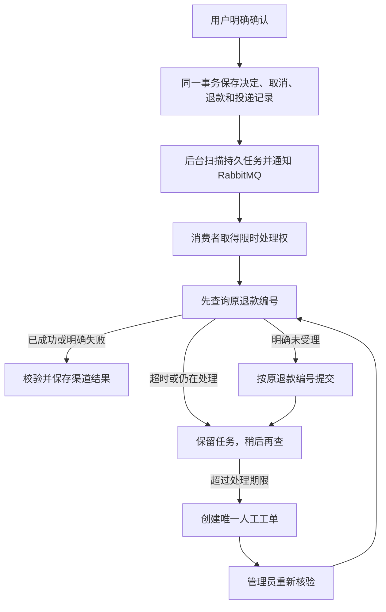

# ServiceFlow 本轮优化报告

日期：2026-11-04。范围：第一批“我的订单、订单咨询、多订单追问”之后的第 2、3、4 批。

这轮把“用户告诉客服想取消订单”后面的执行过程补完整了：用户确认或放弃的决定可以持久保存，取消与退款任务在同一事务中提交，后台自动处理退款，遇到结果不明会查询和转人工，并用真实数据库、消息队列、独立模拟渠道和故障注入验证。同时完成了两项有前后对照的性能与资源优化。

本地访问：[ServiceFlow](http://127.0.0.1:15173)。AI 和 RAG 保持 Cloud 模式；付款渠道是独立的本地模拟服务，不涉及真实资金。本轮验证没有调用收费模型。

## 1. 从用户视角看，具体变了什么

以“取消一笔已付款、尚未发货的耳机订单”为例：

1. 在“我的订单”找到订单，点击“咨询这笔订单”，进入带有该订单上下文的新会话。若直接说“把耳机退了”且匹配多笔订单，会先要求选择。
2. 客服确认订单当前允许取消，显示包含商品、订单号和金额的确认卡。此时订单和退款都没有改变。
3. 点“确认”，服务端重新检查本人身份、订单版本和当前状态，再记录决定、取消订单并创建退款任务。点“放弃本次操作”则记录拒绝，不执行取消。
4. 即使确认响应在网络中丢失，刷新后也可查询该动作的结果；系统不会因为页面不知道结果就自动再次取消。
5. 后台把退款交给独立渠道，核验处理结果，更新订单和付款记录。用户可以在订单详情查看退款状态。
6. 如果渠道一直无法给出明确结果，后台创建人工工单。管理员处理后可以点击“重新核验渠道”，先查原退款单，避免另起一笔退款。

完整编号查询会使用精确查询；输入商品名称或不完整订单号，仍使用原有模糊搜索。

## 2. 第 2 批：让确认、拒绝与恢复有可靠依据

### 原来缺的是什么

页面上的按钮状态、Redis 中的临时上下文和数据库里的订单状态是不同东西。如果订单已取消，但浏览器没有收到响应，仅看页面或缓存就无法判断是否执行过。并发点确认、确认与拒绝同时到达，也需要一个明确的裁决依据。

### 这次怎么实现

新增 MySQL 表 `chat_action`，每张确认卡有唯一的 `actionId`，记录所属客户、会话、订单、生成卡片时的订单版本、有效期和最终决定。

| 情况 | 服务端处理 |
| --- | --- |
| 同一动作重复确认 | 返回已经保存的结果，不再执行一次取消 |
| 确认和拒绝同时到达 | 锁定同一动作行，最先成功提交的决定生效 |
| 两张不同确认卡指向同一订单 | 再锁定订单并核验版本；后来的旧卡不能重复执行 |
| 生成卡片后订单已发货或状态改变 | 拒绝使用过时的确认依据，返回冲突 |
| 动作超过 10 分钟 | 返回过期，不执行 |
| 会话已删除 | 新执行被判为无效 |
| 其他客户拿到 actionId | 不能读取或执行该动作 |

核心事务中依次完成“确认决定 → 取消订单 → 操作账本 → 退款请求 → 后台投递记录”。其中任何一步失败，整体回滚。事务提交后才向浏览器发送执行结果。

可以把事务理解成一份必须完整落地的凭据：不能只记“用户确认了”却没改订单，也不能只取消了订单却没有后续退款任务。

前端在发送确认或拒绝前保存一个很小的待核验标识。响应丢失后调用只读结果接口，而不是重新发副作用请求。历史确认卡恢复时，也先向服务端确认它是否仍是 PENDING。浏览器存储损坏时显示提示并暂停自动恢复，避免根据不完整线索展示可执行的旧卡。

主要代码：

- [ActionDecisionService](../apps/serviceflow-server/src/main/java/com/serviceflow/service/ActionDecisionService.java)：持久动作、权限、锁、版本核验与事务裁决。
- [ChatActionServiceImpl](../apps/serviceflow-server/src/main/java/com/serviceflow/service/impl/ChatActionServiceImpl.java)：事务之后发送 SSE 结果。
- [ChatView](../apps/serviceflow-web/src/views/ChatView.vue)：确认卡、待核验标识、刷新恢复与身份切换隔离。
- [V10 迁移](../apps/serviceflow-server/src/main/resources/db/migration/V10__durable_chat_actions.sql)：动作表和唯一约束。

### 用什么证明

真实 MySQL 集成测试运行三组并发实验，每组 100 轮：

- 同一动作同时收到 20 次确认，只有一次有效执行。
- 确认与拒绝竞争，最终只有一个决定；拒绝先成功提交时没有取消或退款副作用。
- 两个动作同时取消同一订单，至多产生一次有效取消和一个退款请求。

另覆盖事务回滚、越权、订单变化、过期、会话删除和结果查询。浏览器回归覆盖响应丢失、刷新恢复、拒绝响应丢失、账号切换及存储损坏。这里的 300 轮是三组并发实验次数，不等于 300 个独立测试用例。

## 3. 第 3 批：退款由后台推进，异常有恢复路径

### 为什么不能在用户请求里一直等退款

外部渠道可能很慢，也可能已经退款却丢了响应。让用户请求一直等待会占用连接；一超时就重新提交，又可能重复退款。因此把“用户决定”和“渠道执行”分成两段，中间用数据库记录衔接。

### 每一层负责什么

| 部分 | 具体作用 | 为什么需要 |
| --- | --- | --- |
| MySQL 的 refund_delivery | 保存待处理任务、尝试次数、下次执行时间、处理期限和工单 | 服务重启或 MQ 暂停后仍知道哪些退款没完成 |
| 后台发布器 | 每 2 秒扫描可投递任务，用 RabbitMQ Publisher Confirm 确认消息发布 | 任务已落库但消息没发出时可以补发 |
| 两个消费者 | 领取任务；数据库条件更新发放 30 秒处理租约 | 重复消息和多个消费者不能同时随意执行 |
| 租约令牌 | 过期处理者不能覆盖新处理者写入的状态 | 防止慢请求回来后把新状态改坏 |
| 独立退款渠道 | 独立 HTTP 进程和 SQLite 数据库，按退款编号保持幂等 | 能检验系统间真实的通信失败，而不只是修改后端内存变量 |
| 查询、回调校验 | 校验退款编号、金额、尝试次数、事件及终态 | 重复、迟到或冲突回调不能随意改账 |
| 人工工单 | 持续未知 10 分钟后保留线索并转人工 | 异常最终有人处理，且未知不被伪装成失败 |

发布器允许重复通知，因为数据库里的任务才是恢复依据。消费者先查询原退款编号；只有渠道明确没有受理，或前次已明确失败且管理员授权了新尝试，才允许提交。外部 HTTP 调用在数据库事务之外，避免长时间占着数据库锁等网络。

“结果未知”和“退款失败”是两种状态。未知时保留 PROCESSING 并查询；明确 FAILED 后，管理员才可以使用失败重试。重试仍绑定同一个业务退款编号，并增加尝试次数。

主要代码：

- [RefundDispatcher](../apps/serviceflow-server/src/main/java/com/serviceflow/infrastructure/messaging/RefundDispatcher.java)：发布、消费、查询优先与外部调用。
- [RefundDeliveryService](../apps/serviceflow-server/src/main/java/com/serviceflow/service/RefundDeliveryService.java)：领取任务、租约、状态保存、人工移交。
- [RefundChannelClient](../apps/serviceflow-server/src/main/java/com/serviceflow/infrastructure/messaging/RefundChannelClient.java)：独立渠道 HTTP 客户端。
- [本地渠道服务](../apps/refund-channel/server.py)：独立持久化、业务幂等与可控故障。
- [V11 迁移](../apps/serviceflow-server/src/main/resources/db/migration/V11__refund_delivery.sql)：后台任务表。

### 实际做了哪些故障实验

使用专用数据库和新建合成订单，运行真实 HTTP、MySQL、RabbitMQ 两个消费者和独立渠道。没有对用户当前 Cloud 实例注入故障。

| 实验 | 观察到的结果 |
| --- | --- |
| 正常退款并投递 20 条重复消息 | 渠道受理一次、有效退款一次 |
| 渠道已受理但响应丢失 | 通过后续查询恢复；提交次数仍为一次，约 6.19 秒收敛 |
| 渠道回调丢失 | 通过查询恢复；约 5.45 秒收敛 |
| 重复回调 | 保持一次有效退款，不重复改变终态 |
| 明确失败后管理员重试 | 两次受理尝试，最终有效退款一次 |
| 渠道长期不可用 | 创建一张人工工单，不盲目提交；恢复后重新核验可完成 |
| MQ 暂停、任务已落库、后端被强制退出 | 重启后找回任务并完成 |
| 渠道受理后后端中断、渠道也重启 | 两侧持久数据仍可核对，最终不重复退款 |

后端脚本通过 **63/63 个检查点**，覆盖 8 个完整后台故障场景及浏览器场景的准备检查；其中包含 20 条重复投递检查，不能把 63 写成 63 个独立业务场景。另通过 **1 个真实浏览器管理员核验流程**，从页面操作后同时检查 ServiceFlow 数据库和渠道数据库。

证据：[自动退款摘要](../quality/evaluation/results/automatic-refund-2026-11-04.summary.json)。复现命令见[运行手册第 10 节](guides/evaluation-and-refund.md#10-独立渠道与自动退款2026-11-04)。

## 4. 第 4 批：先测瓶颈，再改代码

### 4.1 完整订单号查询

原页面把所有输入都当作 keyword。即使输入完整订单号，SQL 也要检查订单号包含关系和商品字段。极端大客户数据下，执行计划扫描了该客户的 20 万笔订单，并重复执行商品子查询。

这次增加可选参数 `orderNo`，通过等值条件复用已有订单号唯一索引。前端识别完整编号时自动使用它；`keyword` 继续保持原来的模糊语义。本人身份、状态、日期和分页条件仍由后端执行，不因走索引而绕过权限。

没有为这个问题增加缓存或新中间件。实际瓶颈是查询意图被错误地表达成模糊条件，先修正查询更直接。

**测量条件**

- 数据：专用测试库追加 100 万笔合成订单，其中压力客户 20 万笔，普通对照客户 800 笔。20 万笔是制造扫描压力的极端夹具，不代表普通消费者的日常订单量。
- 环境：Ryzen 7 5800H，8 核 16 线程；Docker 可用内存约 7.69 GiB；后端限制 768 MiB，MySQL 限制 512 MiB；Windows 本地共享机器。
- 基线：从提交 `ef8ba849` 单独构建镜像；优化前后复用同一份数据。
- 方法：每档并发预热 5 次，持续发请求 30 秒，再等待已发出请求结束。输入同一完整编号，验证每次都只返回同一笔本人订单。
- 前后路径：旧网页使用 `keyword`，新网页使用 `orderNo`。这是完整编号这一用户操作的前后对照，没有声称旧模糊查询本身变快。

P95 的意思是：本次测量里，95% 的请求在这个时间以内完成。它比只看平均值更能反映用户遇到的慢请求。

| 并发数 | 前 → 后请求数 | 前 → 后吞吐（请求/秒） | 前 → 后 P50（ms） | 前 → 后 P95（ms） | 前 → 后 P99（ms） |
| --- | ---: | ---: | ---: | ---: | ---: |
| 1 | 36 → 2,714 | 1.19 → 90.41 | 824.52 → 6.21 | 973.17 → 29.89 | 1,024.48 → 31.43 |
| 8 | 160 → 32,689 | 5.22 → 1,089.34 | 1,506.25 → 6.76 | 1,672.87 → 10.40 | 1,774.04 → 21.85 |
| 16 | 186 → 47,307 | 5.81 → 1,576.32 | 3,040.75 → 9.62 | 3,440.21 → 14.67 | 3,547.93 → 21.83 |

各档前后错误数均为 0。执行计划从扫描 20 万笔本人订单变为单行唯一索引查找。

**这组数字的适用范围有限。** 这是暖缓存、本机、固定读请求的闭环负载，前后各一次持续测量，不是生产容量上限或统计显著性结论；串行基线只有 36 个样本，尾延迟也受样本量影响。商品关键词查询不在本次加速范围内。普通客户列表只做了 48 请求的小规模对照，P95 从 14.99 ms 变成 25.29 ms，不能据此声称普通列表也更快。

证据：[完整查询对照](../quality/performance/reports/order-lookup-2026-11-04.json)；[复现脚本](../scripts/performance/order_lookup.py)；[参数和运行说明](../quality/performance/README.md#2026-11-04-订单查询与超时资源验证)。

### 4.2 模型调用超时后的资源释放

原来的 `Future.get(timeout)` 只让调用方停止等待，已经提交的任务可能还在后台运行。连续超时会积累仍在执行的任务。

现在保留 Future 引用，在超时或调用线程被中断时执行 `cancel(true)`；中断路径也保留调用线程的中断标识。取消会向任务发出中断信号，任务本身仍须响应中断才能及时退出。

用两轮、每轮 20 个本地可中断替身模拟慢模型，超时为 150 ms，观察期限为超时后 1 秒：

| 指标 | 优化前 | 优化后 |
| --- | ---: | ---: |
| 调用次数 / 超时次数 | 40 / 40 | 40 / 40 |
| 观察时仍运行的任务数 | 40 | 0 |
| 同时运行任务峰值 | 40 | 20 |
| 请求 P95 | 302 ms | 302 ms |

改善的是超时后的本地资源占用，没有测出请求 P95 改善。这个测试不证明第三方模型已经停止推理或停止计费，也没有测量真实云模型吞吐。

证据：[超时对照](../quality/performance/reports/timeout-cancellation-2026-11-04.json)；[执行器](../apps/serviceflow-server/src/main/java/com/serviceflow/ai/AiCallExecutor.java)；[测试](../apps/serviceflow-server/src/test/java/com/serviceflow/ai/AiCallExecutorTimeoutTest.java)。

## 5. 验证结果与交付状态

| 验证项 | 本地结果 | 验证含义 |
| --- | --- | --- |
| 后端完整 Maven verify | 145 项单元测试通过，5 项可选模型测试跳过；20 项集成测试通过；格式及覆盖率门槛通过 | 业务规则、并发、数据库事务和工程质量 |
| 确认卡最终文案补充 | 相关 8 项测试通过 | 商品、订单号和金额取自已查询的订单事实 |
| 前端 | lint、生产构建、13 项单元测试及受影响浏览器测试通过 | 界面、参数传递、确认卡和恢复行为 |
| Python | 41 项评测工具测试、4 项独立渠道测试通过 | 验证脚本与渠道契约 |
| 独立渠道故障注入 | 63/63 检查点及 1 个真实浏览器流程通过 | 重复、超时、回调、重启和人工恢复 |
| 性能对照 | 100 万订单、3 档并发、每档 30 秒；6 组错误均为 0 | 完整编号查询的前后表现 |
| Cloud 实例网页抽查 | 登录、订单列表、精确筛选、订单咨询上下文和输入框聚焦通过 | 最终镜像实际已部署，检查过程模型调用为 0 |

已完成的远程检查点：

- 持久确认与浏览器恢复修正：[`a774f0db`](https://github.com/Titans23/serviceflow/commit/a774f0db)，[CI 成功](https://github.com/Titans23/serviceflow/actions/runs/41777089062)。
- 独立渠道、自动退款和故障验证：[`ef8ba849`](https://github.com/Titans23/serviceflow/commit/ef8ba849)，[CI 成功](https://github.com/Titans23/serviceflow/actions/runs/41778590286)。

本报告与性能改动在同一后续提交交付；其远程状态以[对应提交的 Actions](https://github.com/Titans23/serviceflow/actions/workflows/ci.yml)为准，发布完成消息另列具体 SHA 和运行链接。已通过的上一检查点不代表后续提交自动通过。

### 本地 Cloud 部署核对

- 7 个服务健康，包括新增的独立渠道；AI=cloud、RAG=cloud、自动退款开启、手工回调沙箱关闭。
- Flyway V10、V11 均迁移成功。
- 原有 40 笔订单、26 个商品、26 份有效知识文档保留；待处理知识入库数为 0。
- 升级完成时后台投递记录和渠道退款记录均为 0，没有自动补投历史退款。
- 密钥仅保存在本地被忽略的环境文件中；没有提交密钥、用户上传资料或原始模型回答。

## 6. 怎样读代码和讲清楚这个项目

建议沿一笔订单看五个位置，而不是先背组件名称：

1. **OrderConversation**：为什么有多笔订单时要追问？卡片里采用哪笔订单的事实？模型没有决定客户身份和退款金额。
2. **ActionDecisionService**：用户确认怎样变成数据库里唯一、可重放查询的决定？为什么检查订单版本？
3. **OrderServiceImpl**：订单、操作账本、退款和投递记录怎样一起提交？
4. **RefundDispatcher / RefundDeliveryService**：响应丢失为什么先查？重复消息、过期处理者和进程重启怎样处理？
5. **ServiceFlowIntegrationIT 与故障脚本**：最终断言检查了什么？是只看 HTTP 成功，还是读回两侧数据确认没有重复退款？

这轮后端深度体现在事务边界、状态机、行锁与版本核验、业务幂等、持久任务、租约、回调校验和故障恢复。Agent 部分体现为在有上下文的多轮对话中定位业务对象，要求明确确认，再把执行交给受权限和状态规则约束的后端。

本轮没有训练新模型，也没有新增一次真实 Cloud 模型能力评测。因此可以说“业务执行和恢复机制已验证”，不能把这些受控测试说成任意自然语言任务的模型成功率。历史 Cloud 评测仍保留在原报告中，不能替代本次实现的模型验收。

## 7. 当前边界

独立模拟渠道能够验证跨进程故障与幂等，但还没有接入真实支付机构的签名、资金清结算、部分退款和跨币种。存量未完成退款没有自动补投；迁移前仅存在 Redis 中的旧待确认卡，需要重新发起咨询生成新卡。关闭标签或清空浏览器存储，也不保证自动找回尚未收到响应的决定，但服务端持久决定仍可按原动作编号查询。

本轮已经完成第 2、3、4 批的本地实现、相关验证和 Cloud 部署；后续能力应在这条可验证的业务链上继续扩展。
