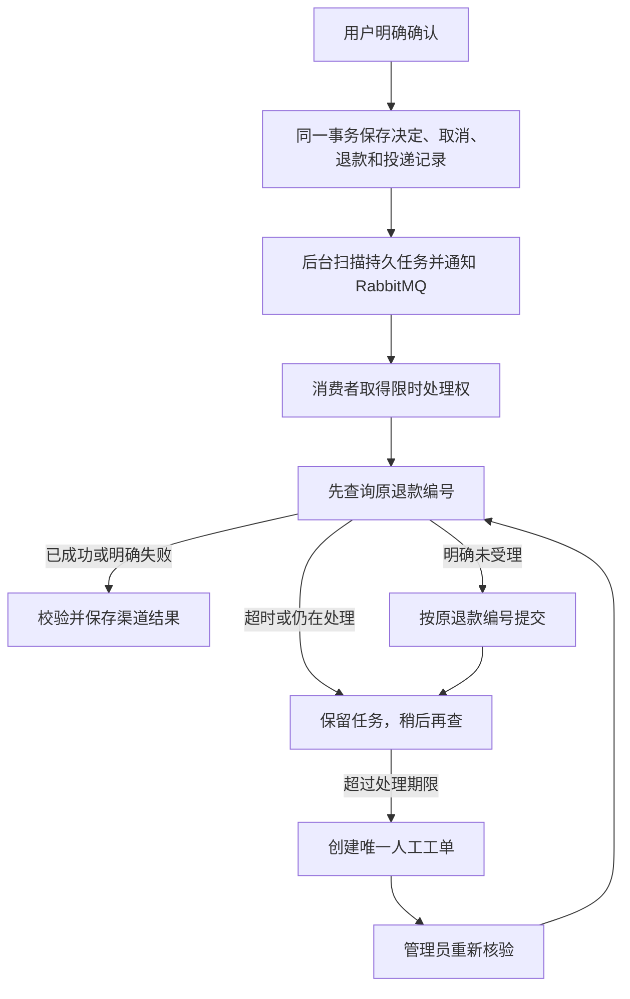

# ServiceFlow 第 1～4 批完整优化报告

日期：2026-11-04。范围：第 1～4 批，作为同一次业务闭环优化统一记录，包括“我的订单与 Agent 订单咨询”“可靠确认与恢复”“后台退款与人工接手”“性能与资源优化”。

这轮从用户找到订单开始，把咨询、追问、确认、执行和异常恢复连接起来：用户可以查看自己的订单，从具体订单进入新客服会话，也可以让 Agent 按商品和日期查询；匹配多笔时先明确选择，再生成确认卡。用户的确认或放弃决定持久保存，取消与退款任务在同一事务中提交，后台自动处理退款，结果不明时查询和转人工。验证覆盖真实数据库、消息队列、独立模拟渠道和故障注入，同时包含两项有前后对照的性能与资源优化。

| 批次 | 解决的业务问题 | 交付内容 |
| --- | --- | --- |
| 第 1 批 | 用户怎样找到并明确要处理的订单 | 我的订单、订单咨询入口、受约束的 Agent 查询、多订单追问与上下文隔离 |
| 第 2 批 | 怎样确认用户授权，并在重复请求或丢响应时保持一致 | 持久确认与拒绝、事务裁决、只读结果恢复 |
| 第 3 批 | 用户确认后，退款怎样自动完成并处理异常 | 持久任务、独立渠道、查询核验、幂等重试与人工接手 |
| 第 4 批 | 已有流程的瓶颈在哪里，改动是否有效 | 完整订单号精确查询、超时任务取消、可复现的前后测量 |

本地访问：[ServiceFlow](http://127.0.0.1:15173)。AI 和 RAG 保持 Cloud 模式；付款渠道是独立的本地模拟服务，不涉及真实资金。本轮验证没有调用收费模型。

## 整体业务流程：从用户视角看，具体变了什么

以“取消一笔已付款、尚未发货的耳机订单”为例：

1. 在“我的订单”找到订单，点击“咨询这笔订单”，进入带有该订单上下文的新会话。若直接说“把耳机退了”且匹配多笔订单，会先要求选择。
2. 客服确认订单当前允许取消，显示包含商品、订单号和金额的确认卡。此时订单和退款都没有改变。
3. 点“确认”，服务端重新检查本人身份、订单版本和当前状态，再记录决定、取消订单并创建退款任务。点“放弃本次操作”则记录拒绝，不执行取消。
4. 即使确认响应在网络中丢失，刷新后也可查询该动作的结果；系统不会因为页面不知道结果就自动再次取消。
5. 后台把退款交给独立渠道，核验处理结果，更新订单和付款记录。用户可以在订单详情查看退款状态。
6. 如果渠道一直无法给出明确结果，后台创建人工工单。管理员处理后可以点击“重新核验渠道”，先查原退款单，避免另起一笔退款。

完整编号查询会使用精确查询；输入商品名称或不完整订单号，仍使用原有模糊搜索。

## 1. 第 1 批：我的订单、订单咨询与 Agent 多订单追问

### 原来缺的是什么

订单数据、聊天入口和用户想处理的对象之间缺少清楚的连接。用户不能总靠手输订单号；“昨天买的耳机不要了”也可能对应多笔订单。如果沿用旧会话的订单上下文，后续确认和退款即使技术上执行正确，也可能处理了错误的对象。

第一批先解决“找到哪笔订单、这笔订单属于谁、用户是否明确选中了它”，把确定的业务对象交给后续确认流程。

### 1.1 我的订单：本人查询、筛选、分页与详情

新增客户订单列表，支持商品名称、型号、SKU、类别、订单号、状态和日期筛选，展示订单商品和金额，并可进入详情查看付款、退款和物流。

后端从已登录身份取得 customerId，查询始终带上所属客户条件。前端传来的订单号和分页游标也要重新校验归属，不能通过改 URL 或请求参数查看他人的订单。

列表使用“创建时间 + 订单 ID”作为分页位置。同一时间有多笔订单时，仍能稳定区分前后顺序；商品明细按一页订单批量读取，避免展示 10 笔订单就额外执行 10 次商品查询。V9 增加对应的客户、创建时间与 ID 组合索引。日期按北京时间解释，结束日期包含当天全天。

前端另外保存已经提交的筛选条件。用户改了输入框但还没有点筛选时，“加载更多”继续沿用原来的条件，避免把两个查询结果拼成一个列表。第一批实现的是这些查询基础；完整订单号的精确参数和性能对照属于第 4 批。

### 1.2 从订单进入客服：新会话与明确上下文

点击“咨询这笔订单”会创建新会话，并通过 pageContext.orderNo 传递当前订单。后端使用这个上下文前再次查询本人订单；页面参数只是用户指定对象的线索，不是访问授权。

进入会话后，页面显示正在咨询的订单，输入框自动聚焦。后续问“它的物流呢”可以指向已经选定的订单；切换会话会清理页面中的订单和确认卡，重新查询其他订单也会清除旧的订单指代。刷新订单咨询页不会再额外新建一遍会话。

这样，新订单咨询、旧聊天记录以及新一轮订单搜索各有明确边界，避免错误沿用之前处理的订单。

### 1.3 Agent 查询：把一句话变成受约束的查询计划

例如用户说“昨天买的耳机不要了”，Cloud 模式下，模型根据当前日期和对话上下文生成结构化查询计划，表达“按耳机和昨天的日期查询，用户目的是取消”。后端解析、校验，再调用既有订单服务。明确订单号和简单序号也有直接解析路径。

| 允许的计划 | 含义 | 后端执行规则 |
| --- | --- | --- |
| SEARCH_ORDERS | 按商品、状态、日期查询 | 只能查当前客户；校验条件和日期 |
| READ_CURRENT | 查看已经明确的当前订单 | 必须存在有效上下文，并再次校验所属客户 |
| SELECT_CANDIDATE | 从当前候选中选择一笔 | 序号必须落在本次候选范围内 |
| ASK_USER | 信息不足，继续追问 | 不自行猜一笔订单执行 |

模型不提供 customerId、不生成 SQL，也不决定退款金额。订单状态、金额和物流由后端实际查询结果生成。这是一次受约束的规划加后端执行，并没有引入无限循环调用工具的 Agent 框架。

### 1.4 多订单追问：选择对象与执行操作分开

查询唯一命中时展示订单；多笔命中时发送 order_selection_required 候选卡，最多展示 10 笔。结果更多时提示缩小条件。用户可以点卡片，也可以回复“第二笔”。

候选集合、queryId 和待处理的取消意图按用户主体及会话保存在 Redis，有效期为 30 分钟。点击卡片时，后端核对 queryId 和订单是否属于本次候选，再重新读取本人订单。旧查询的卡片、其他会话的候选和越界序号不能用来选择订单。新的搜索替换旧候选，即使新搜索没有结果，也不会回退到旧订单。

如果用户最初要取消，选定订单后会继续到取消确认卡，但选择本身不会修改订单或创建退款。这样，“我选的是哪笔”和“我同意取消”是两个可分别验证的步骤，第二步交给第 2 批处理。

候选卡和订单事实也随助手消息写入 MySQL，支持历史展示和相同 clientRequestId 的响应重放。历史里还能看到一张卡，不代表它永远可执行；历史展示不会延长 Redis 候选有效期。

主要代码：

- [OrdersView](../apps/serviceflow-web/src/views/OrdersView.vue)、[OrderController](../apps/serviceflow-server/src/main/java/com/serviceflow/controller/OrderController.java)：列表、筛选、详情及本人查询入口。
- [OrderServiceImpl](../apps/serviceflow-server/src/main/java/com/serviceflow/service/impl/OrderServiceImpl.java)、[OrderMapper](../apps/serviceflow-server/src/main/resources/mapper/OrderMapper.xml)、[V9 迁移](../apps/serviceflow-server/src/main/resources/db/migration/V9__customer_order_listing.sql)：查询校验、组合游标、批量明细与索引。
- [CloudAiGateway](../apps/serviceflow-server/src/main/java/com/serviceflow/ai/CloudAiGateway.java)、[OrderConversation](../apps/serviceflow-server/src/main/java/com/serviceflow/agent/OrderConversation.java)：查询计划解析、订单查询、候选选择与确认衔接。
- [ChatMemory](../apps/serviceflow-server/src/main/java/com/serviceflow/infrastructure/redis/ChatMemory.java)、[ChatServiceImpl](../apps/serviceflow-server/src/main/java/com/serviceflow/service/impl/ChatServiceImpl.java)、[ChatView](../apps/serviceflow-web/src/views/ChatView.vue)：会话状态、消息持久化、响应重放及前端上下文。

### 用什么证明

| 验证层 | 已覆盖的行为 |
| --- | --- |
| 订单查询单元与真实数据库测试 | 本人隔离、筛选、北京时间日期边界、分页和批量商品明细；外部客户的游标不可使用 |
| 查询计划与会话单元测试 | 查询条件解析、非法计划拒绝、多订单选择、旧 queryId、越权上下文、无结果清理、无效日期及越界序号 |
| 真实 HTTP、MySQL 与 Redis 集成测试 | 查询得到候选 → 选择生成确认卡 → 继续追问 → 请求重放 → 旧候选失效；读取数据库确认选择后订单仍为 PAID，操作账本和退款数仍为 0 |
| 3 个订单浏览器用例 | 新会话与上下文、聚焦及回车发送、候选选择和会话切换；建会话期间保护输入；列表筛选、分页及详情 |

测试入口：[OrderConversationTest](../apps/serviceflow-server/src/test/java/com/serviceflow/agent/OrderConversationTest.java)、[CloudAiGatewayTest](../apps/serviceflow-server/src/test/java/com/serviceflow/ai/CloudAiGatewayTest.java)、[ServiceFlowIntegrationIT](../apps/serviceflow-server/src/test/java/com/serviceflow/ServiceFlowIntegrationIT.java)、[orders.spec.ts](../apps/serviceflow-web/e2e/orders.spec.ts)。浏览器用例以 API mock 检查交互；真实业务状态由集成测试另行核验。上述用例已包含在第 5 节的全量结果中，不重复相加。

第一批最终提交 d680e690 的 CI 已通过，后续完整实现的 CI 也继续运行这些回归。模型计划解析使用受控输出测试，集成环境使用受控 AI；这能证明执行约束和状态流转，不能据此宣称真实 Cloud 模型对任意自然语言的识别准确率。

## 2. 第 2 批：让确认、拒绝与恢复有可靠依据

### 原来缺的是什么

页面上的按钮状态、Redis 中的临时上下文和数据库里的订单状态是不同东西。如果订单已取消，但浏览器没有收到响应，仅看页面或缓存就无法判断是否执行过。并发点确认、确认与拒绝同时到达，也需要一个明确的裁决依据。

### 这次怎么实现

新增 MySQL 表 `chat_action`，每张确认卡有唯一的 `actionId`，记录所属客户、会话、订单、生成卡片时的订单版本、有效期和最终决定。

| 情况 | 服务端处理 |
| --- | --- |
| 同一动作重复确认 | 返回已经保存的结果，不再执行一次取消 |
| 确认和拒绝同时到达 | 锁定同一动作行，最先成功提交的决定生效 |
| 两张不同确认卡指向同一订单 | 再锁定订单并核验版本；后来的旧卡不能重复执行 |
| 生成卡片后订单已发货或状态改变 | 拒绝使用过时的确认依据，返回冲突 |
| 动作超过 10 分钟 | 返回过期，不执行 |
| 会话已删除 | 新执行被判为无效 |
| 其他客户拿到 actionId | 不能读取或执行该动作 |

核心事务中依次完成“确认决定 → 取消订单 → 操作账本 → 退款请求 → 后台投递记录”。其中任何一步失败，整体回滚。事务提交后才向浏览器发送执行结果。

可以把事务理解成一份必须完整落地的凭据：不能只记“用户确认了”却没改订单，也不能只取消了订单却没有后续退款任务。

前端在发送确认或拒绝前保存一个很小的待核验标识。响应丢失后调用只读结果接口，而不是重新发副作用请求。历史确认卡恢复时，也先向服务端确认它是否仍是 PENDING。浏览器存储损坏时显示提示并暂停自动恢复，避免根据不完整线索展示可执行的旧卡。

主要代码：

- [ActionDecisionService](../apps/serviceflow-server/src/main/java/com/serviceflow/service/ActionDecisionService.java)：持久动作、权限、锁、版本核验与事务裁决。
- [ChatActionServiceImpl](../apps/serviceflow-server/src/main/java/com/serviceflow/service/impl/ChatActionServiceImpl.java)：事务之后发送 SSE 结果。
- [ChatView](../apps/serviceflow-web/src/views/ChatView.vue)：确认卡、待核验标识、刷新恢复与身份切换隔离。
- [V10 迁移](../apps/serviceflow-server/src/main/resources/db/migration/V10__durable_chat_actions.sql)：动作表和唯一约束。

### 用什么证明

真实 MySQL 集成测试运行三组并发实验，每组 100 轮：

- 同一动作同时收到 20 次确认，只有一次有效执行。
- 确认与拒绝竞争，最终只有一个决定；拒绝先成功提交时没有取消或退款副作用。
- 两个动作同时取消同一订单，至多产生一次有效取消和一个退款请求。

另覆盖事务回滚、越权、订单变化、过期、会话删除和结果查询。浏览器回归覆盖响应丢失、刷新恢复、拒绝响应丢失、账号切换及存储损坏。这里的 300 轮是三组并发实验次数，不等于 300 个独立测试用例。

## 3. 第 3 批：退款由后台推进，异常有恢复路径

### 为什么不能在用户请求里一直等退款

外部渠道可能很慢，也可能已经退款却丢了响应。让用户请求一直等待会占用连接；一超时就重新提交，又可能重复退款。因此把“用户决定”和“渠道执行”分成两段，中间用数据库记录衔接。

### 每一层负责什么

| 部分 | 具体作用 | 为什么需要 |
| --- | --- | --- |
| MySQL 的 refund_delivery | 保存待处理任务、尝试次数、下次执行时间、处理期限和工单 | 服务重启或 MQ 暂停后仍知道哪些退款没完成 |
| 后台发布器 | 每 2 秒扫描可投递任务，用 RabbitMQ Publisher Confirm 确认消息发布 | 任务已落库但消息没发出时可以补发 |
| 两个消费者 | 领取任务；数据库条件更新发放 30 秒处理租约 | 重复消息和多个消费者不能同时随意执行 |
| 租约令牌 | 过期处理者不能覆盖新处理者写入的状态 | 防止慢请求回来后把新状态改坏 |
| 独立退款渠道 | 独立 HTTP 进程和 SQLite 数据库，按退款编号保持幂等 | 能检验系统间真实的通信失败，而不只是修改后端内存变量 |
| 查询、回调校验 | 校验退款编号、金额、尝试次数、事件及终态 | 重复、迟到或冲突回调不能随意改账 |
| 人工工单 | 持续未知 10 分钟后保留线索并转人工 | 异常最终有人处理，且未知不被伪装成失败 |

发布器允许重复通知，因为数据库里的任务才是恢复依据。消费者先查询原退款编号；只有渠道明确没有受理，或前次已明确失败且管理员授权了新尝试，才允许提交。外部 HTTP 调用在数据库事务之外，避免长时间占着数据库锁等网络。

“结果未知”和“退款失败”是两种状态。未知时保留 PROCESSING 并查询；明确 FAILED 后，管理员才可以使用失败重试。重试仍绑定同一个业务退款编号，并增加尝试次数。

主要代码：

- [RefundDispatcher](../apps/serviceflow-server/src/main/java/com/serviceflow/infrastructure/messaging/RefundDispatcher.java)：发布、消费、查询优先与外部调用。
- [RefundDeliveryService](../apps/serviceflow-server/src/main/java/com/serviceflow/service/RefundDeliveryService.java)：领取任务、租约、状态保存、人工移交。
- [RefundChannelClient](../apps/serviceflow-server/src/main/java/com/serviceflow/infrastructure/messaging/RefundChannelClient.java)：独立渠道 HTTP 客户端。
- [本地渠道服务](../apps/refund-channel/server.py)：独立持久化、业务幂等与可控故障。
- [V11 迁移](../apps/serviceflow-server/src/main/resources/db/migration/V11__refund_delivery.sql)：后台任务表。

### 实际做了哪些故障实验

使用专用数据库和新建合成订单，运行真实 HTTP、MySQL、RabbitMQ 两个消费者和独立渠道。没有对用户当前 Cloud 实例注入故障。

| 实验 | 观察到的结果 |
| --- | --- |
| 正常退款并投递 20 条重复消息 | 渠道受理一次、有效退款一次 |
| 渠道已受理但响应丢失 | 通过后续查询恢复；提交次数仍为一次，约 6.19 秒收敛 |
| 渠道回调丢失 | 通过查询恢复；约 5.45 秒收敛 |
| 重复回调 | 保持一次有效退款，不重复改变终态 |
| 明确失败后管理员重试 | 两次受理尝试，最终有效退款一次 |
| 渠道长期不可用 | 创建一张人工工单，不盲目提交；恢复后重新核验可完成 |
| MQ 暂停、任务已落库、后端被强制退出 | 重启后找回任务并完成 |
| 渠道受理后后端中断、渠道也重启 | 两侧持久数据仍可核对，最终不重复退款 |

后端脚本通过 **63/63 个检查点**，覆盖 8 个完整后台故障场景及浏览器场景的准备检查；其中包含 20 条重复投递检查，不能把 63 写成 63 个独立业务场景。另通过 **1 个真实浏览器管理员核验流程**，从页面操作后同时检查 ServiceFlow 数据库和渠道数据库。

证据：[自动退款摘要](../quality/evaluation/results/automatic-refund-2026-11-04.summary.json)。复现命令见[运行手册第 10 节](guides/evaluation-and-refund.md#10-独立渠道与自动退款2026-11-04)。

## 4. 第 4 批：先测瓶颈，再改代码

### 4.1 完整订单号查询

原页面把所有输入都当作 keyword。即使输入完整订单号，SQL 也要检查订单号包含关系和商品字段。极端大客户数据下，执行计划扫描了该客户的 20 万笔订单，并重复执行商品子查询。

这次增加可选参数 `orderNo`，通过等值条件复用已有订单号唯一索引。前端识别完整编号时自动使用它；`keyword` 继续保持原来的模糊语义。本人身份、状态、日期和分页条件仍由后端执行，不因走索引而绕过权限。

没有为这个问题增加缓存或新中间件。实际瓶颈是查询意图被错误地表达成模糊条件，先修正查询更直接。

**测量条件**

- 数据：专用测试库追加 100 万笔合成订单，其中压力客户 20 万笔，普通对照客户 800 笔。20 万笔是制造扫描压力的极端夹具，不代表普通消费者的日常订单量。
- 环境：Ryzen 7 5800H，8 核 16 线程；Docker 可用内存约 7.69 GiB；后端限制 768 MiB，MySQL 限制 512 MiB；Windows 本地共享机器。
- 基线：从提交 `ef8ba849` 单独构建镜像；优化前后复用同一份数据。
- 方法：每档并发预热 5 次，持续发请求 30 秒，再等待已发出请求结束。输入同一完整编号，验证每次都只返回同一笔本人订单。
- 前后路径：旧网页使用 `keyword`，新网页使用 `orderNo`。这是完整编号这一用户操作的前后对照，没有声称旧模糊查询本身变快。

P95 的意思是：本次测量里，95% 的请求在这个时间以内完成。它比只看平均值更能反映用户遇到的慢请求。

| 并发数 | 前 → 后请求数 | 前 → 后吞吐（请求/秒） | 前 → 后 P50（ms） | 前 → 后 P95（ms） | 前 → 后 P99（ms） |
| --- | ---: | ---: | ---: | ---: | ---: |
| 1 | 36 → 2,714 | 1.19 → 90.41 | 824.52 → 6.21 | 973.17 → 29.89 | 1,024.48 → 31.43 |
| 8 | 160 → 32,689 | 5.22 → 1,089.34 | 1,506.25 → 6.76 | 1,672.87 → 10.40 | 1,774.04 → 21.85 |
| 16 | 186 → 47,307 | 5.81 → 1,576.32 | 3,040.75 → 9.62 | 3,440.21 → 14.67 | 3,547.93 → 21.83 |

各档前后错误数均为 0。执行计划从扫描 20 万笔本人订单变为单行唯一索引查找。

**这组数字的适用范围有限。** 这是暖缓存、本机、固定读请求的闭环负载，前后各一次持续测量，不是生产容量上限或统计显著性结论；串行基线只有 36 个样本，尾延迟也受样本量影响。商品关键词查询不在本次加速范围内。普通客户列表只做了 48 请求的小规模对照，P95 从 14.99 ms 变成 25.29 ms，不能据此声称普通列表也更快。

证据：[完整查询对照](../quality/performance/reports/order-lookup-2026-11-04.json)；[复现脚本](../scripts/performance/order_lookup.py)；[参数和运行说明](../quality/performance/README.md#2026-11-04-订单查询与超时资源验证)。

### 4.2 模型调用超时后的资源释放

原来的 `Future.get(timeout)` 只让调用方停止等待，已经提交的任务可能还在后台运行。连续超时会积累仍在执行的任务。

现在保留 Future 引用，在超时或调用线程被中断时执行 `cancel(true)`；中断路径也保留调用线程的中断标识。取消会向任务发出中断信号，任务本身仍须响应中断才能及时退出。

用两轮、每轮 20 个本地可中断替身模拟慢模型，超时为 150 ms，观察期限为超时后 1 秒：

| 指标 | 优化前 | 优化后 |
| --- | ---: | ---: |
| 调用次数 / 超时次数 | 40 / 40 | 40 / 40 |
| 观察时仍运行的任务数 | 40 | 0 |
| 同时运行任务峰值 | 40 | 20 |
| 请求 P95 | 302 ms | 302 ms |

改善的是超时后的本地资源占用，没有测出请求 P95 改善。这个测试不证明第三方模型已经停止推理或停止计费，也没有测量真实云模型吞吐。

证据：[超时对照](../quality/performance/reports/timeout-cancellation-2026-11-04.json)；[执行器](../apps/serviceflow-server/src/main/java/com/serviceflow/ai/AiCallExecutor.java)；[测试](../apps/serviceflow-server/src/test/java/com/serviceflow/ai/AiCallExecutorTimeoutTest.java)。

## 5. 验证结果与交付状态

| 验证项 | 本地结果 | 验证含义 |
| --- | --- | --- |
| 第 1 批订单与 Agent 回归 | 本人查询、多订单追问、候选持久化及重放测试通过；3 个订单浏览器用例通过，已包含在下列套件中 | 先明确本人订单，再进入确认流程；不重复累计测试数量 |
| 后端完整 Maven verify | 145 项单元测试通过，5 项可选模型测试跳过；20 项集成测试通过；格式及覆盖率门槛通过 | 业务规则、并发、数据库事务和工程质量 |
| 确认卡最终文案补充 | 相关 8 项测试通过 | 商品、订单号和金额取自已查询的订单事实 |
| 前端 | lint、生产构建、13 项单元测试及受影响浏览器测试通过 | 界面、参数传递、确认卡和恢复行为 |
| Python | 41 项评测工具测试、4 项独立渠道测试通过 | 验证脚本与渠道契约 |
| 独立渠道故障注入 | 63/63 检查点及 1 个真实浏览器流程通过 | 重复、超时、回调、重启和人工恢复 |
| 性能对照 | 100 万订单、3 档并发、每档 30 秒；6 组错误均为 0 | 完整编号查询的前后表现 |
| Cloud 实例网页抽查 | 登录、订单列表、精确筛选、订单咨询上下文和输入框聚焦通过 | 最终镜像实际已部署，检查过程模型调用为 0 |

已完成的远程检查点：

- 第 1 批我的订单与 Agent 订单咨询：[`16047b92`](https://github.com/Titans23/serviceflow/commit/16047b92)、[`773c4f4c`](https://github.com/Titans23/serviceflow/commit/773c4f4c)；分页筛选修正后最终提交为 [`d680e690`](https://github.com/Titans23/serviceflow/commit/d680e690)，[CI 成功](https://github.com/Titans23/serviceflow/actions/runs/41771586156)。
- 持久确认与浏览器恢复修正：[`a774f0db`](https://github.com/Titans23/serviceflow/commit/a774f0db)，[CI 成功](https://github.com/Titans23/serviceflow/actions/runs/41777089062)。
- 独立渠道、自动退款和故障验证：[`ef8ba849`](https://github.com/Titans23/serviceflow/commit/ef8ba849)，[CI 成功](https://github.com/Titans23/serviceflow/actions/runs/41778590286)。
- 第 4 批性能优化及报告初版：[`57859526`](https://github.com/Titans23/serviceflow/commit/5785952661b866d497e868332b2ef8f3a6227395)，[CI 的 7 个任务全部成功](https://github.com/Titans23/serviceflow/actions/runs/41786472747)，包含前面各批的业务回归。

本次报告补全只调整文档，依据已有代码、测试和 CI 记录整理第 1～4 批；应用代码与部署保持上述已验证版本。文档检查点的远程状态以[对应提交的 Actions](https://github.com/Titans23/serviceflow/actions/workflows/ci.yml)为准，不把历史实现的通过结果冒充新文档提交的 CI 状态。

### 本地 Cloud 部署核对

- 7 个服务健康，包括新增的独立渠道；AI=cloud、RAG=cloud、自动退款开启、手工回调沙箱关闭。
- Flyway V10、V11 均迁移成功。
- 原有 40 笔订单、26 个商品、26 份有效知识文档保留；待处理知识入库数为 0。
- 升级完成时后台投递记录和渠道退款记录均为 0，没有自动补投历史退款。
- 密钥仅保存在本地被忽略的环境文件中；没有提交密钥、用户上传资料或原始模型回答。

## 6. 怎样读代码和讲清楚这个项目

建议沿一笔订单看六个位置，而不是先背组件名称：

1. **OrdersView / OrderController / OrderMapper**：列表为什么只能查本人订单？筛选、分页、详情和订单咨询怎样连接？
2. **CloudAiGateway / OrderConversation / ChatMemory**：一句话怎样变成查询计划？为什么多笔订单要追问？候选和当前订单如何绑定会话？模型没有决定客户身份和退款金额。
3. **ActionDecisionService**：用户确认怎样变成数据库里唯一、可重放查询的决定？为什么检查订单版本？
4. **OrderServiceImpl**：订单、操作账本、退款和投递记录怎样一起提交？
5. **RefundDispatcher / RefundDeliveryService**：响应丢失为什么先查？重复消息、过期处理者和进程重启怎样处理？
6. **ServiceFlowIntegrationIT 与故障脚本**：最终断言检查了什么？是只看 HTTP 成功，还是读回两侧数据确认没有重复退款？

这轮后端深度体现在事务边界、状态机、行锁与版本核验、业务幂等、持久任务、租约、回调校验和故障恢复。Agent 部分体现为在有上下文的多轮对话中定位业务对象，要求明确确认，再把执行交给受权限和状态规则约束的后端。

本轮没有训练新模型，也没有新增一次真实 Cloud 模型能力评测。因此可以说“业务执行和恢复机制已验证”，不能把这些受控测试说成任意自然语言任务的模型成功率。历史 Cloud 评测仍保留在原报告中，不能替代本次实现的模型验收。

## 7. 当前边界

独立模拟渠道能够验证跨进程故障与幂等，但还没有接入真实支付机构的签名、资金清结算、部分退款和跨币种。存量未完成退款没有自动补投；迁移前仅存在 Redis 中的旧待确认卡，需要重新发起咨询生成新卡。关闭标签或清空浏览器存储，也不保证自动找回尚未收到响应的决定，但服务端持久决定仍可按原动作编号查询。

第 1～4 批共同完成了“找到本人订单 → 明确处理对象 → 用户授权 → 后台执行 → 结果核验 → 异常恢复”的业务链，本地实现、相关验证和 Cloud 部署均已完成。后续能力应在这条可验证的业务链上继续扩展。
